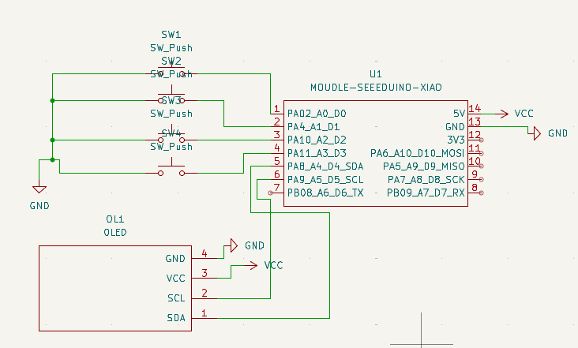
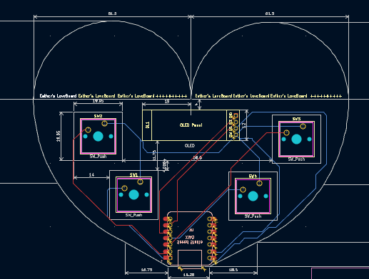
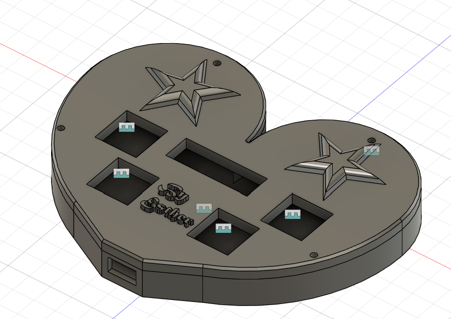
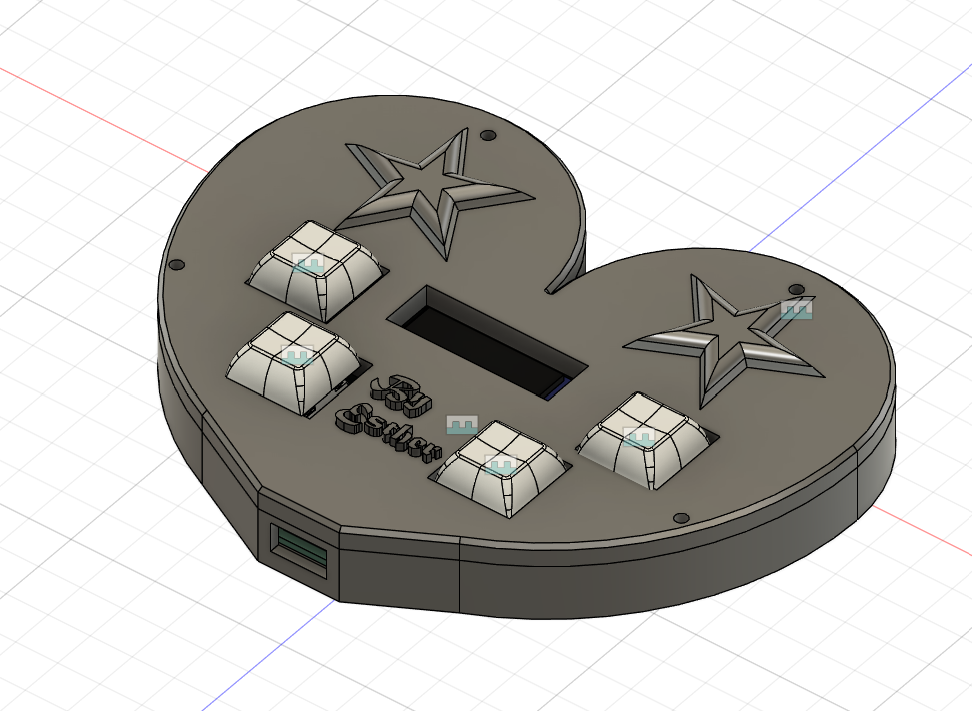

# LoveBoard

The LoveBoard is a 4-key macro pad with an OLED display. I made it to easily access shortcuts I use frequently (copy, paste, cut, delete).

I created the macropad with only 4 keys just because I'm a beginner at PCB design (if I were a bit more experienced, I would've designed the PCB with more keys lol; it was a struggle just to add 4 :cry:), but I'm happy with how it turned out so far!

## Photos

### Schematic

### PCB Design

### Case

### Full Assembly

The case was designed in AutoDesk! Deeper learning curve compared to Onshape (what I'm used to).

## Bill of Materials

- 4x Cherry MX Switches
- 128x32 OLED Display
